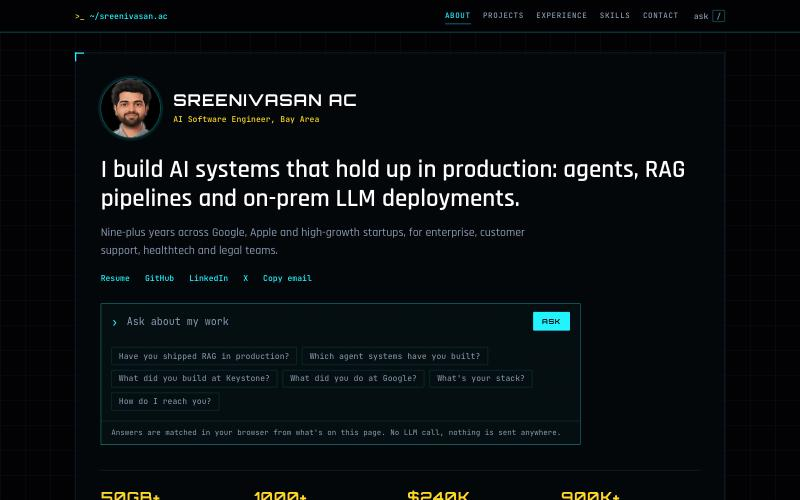
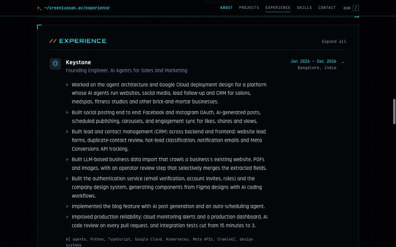

## Portfolio Website (Vite + pnpm)

Sci-fi HUD single-page portfolio (static and readable: no sound, particles or glitch effects) built with vanilla HTML/CSS/JS and bundled with Vite.

**Live Site:** https://sreenivasanac.github.io/portfolio_website/





---

## Design & Content (Where to Edit)

- **Theme:** `src/css/main.css` is the whole stylesheet. The colours (one accent, `--accent`) and the two fonts are tokens at the top of the file.
- **Sections:** one HTML partial each in `src/html/` (hero, projects, experience, skills, education, contact), assembled by `index.html`.
- **Ask box:** `public/js/ask.js`. Visitors type a plain-language question and get an answer matched in the browser against the `KB` list in that file (no backend, no LLM call). Each answer cites blocks on the page by element id (`xp-*` for roles, `pj-*` for projects), so keep those ids in sync when adding content.
  - Link straight to an answer with `?q=`, e.g. `…/portfolio_website/?q=rag in production`.
  - After editing `KB`, open the site with `?asktest` and check the console: it runs the matcher self-check.
- **Role details modal:** "Full story" links open content from `public/js/company-data.js`.
- **Motion:** only the portrait that follows the cursor (`public/js/portrait_gaze.js`) and the word-by-word answer reveal. `prefers-reduced-motion` turns both transitions off.

---

## Tech & Structure (High Level)

- **Build tool:** Vite (`vite.config.js` + custom `vite-plugin-no-module.js` so the build works over `file://` as well as a web server).
- **Package manager:** `pnpm` (see `package.json`, `pnpm-lock.yaml`).
- **Entry points:**
  - `index.html` – main HTML shell used by Vite.
  - `src/main.js` – JS entry, wires up modular HTML/CSS.
- **Source assets:**
  - `src/` – HTML partials and modular CSS.
  - `public/` – static assets (images, sounds, JS) copied as‑is.
- **Build output:**
  - `dist/` – generated static site (HTML, JS, CSS, assets) ready to host or open directly.

---

## Running Locally

```bash
# Install dependencies
pnpm install

# Start dev server (http://localhost:5173)
pnpm run dev

# Build optimized static site into dist/
pnpm run build

# Preview the production build locally
pnpm run preview
```

> After `pnpm run build`, you can also open `dist/index.html` directly in a browser (no server required).

---

## Deployment

### Automatic Deployment (GitHub Pages)

This repository is configured for **automatic deployment to GitHub Pages** via GitHub Actions.

**How it works:**
1. Push to the `main` branch
2. GitHub Actions automatically builds the site using `pnpm run build`
3. The `dist/` folder is deployed to GitHub Pages
4. Site is live at: https://sreenivasanac.github.io/portfolio_website/

**First-time setup:**
1. Go to your repository **Settings → Pages**
2. Under **Source**, select **"GitHub Actions"** (not "Deploy from a branch")
3. Push to `main` branch to trigger deployment

The workflow file is located at `.github/workflows/deploy.yml` and runs on every push to `main`.

### Manual Deployment

You can also manually deploy to other static hosts (Netlify, Vercel, etc.):

```bash
pnpm run build     # produce dist/
# Upload dist/ folder to your hosting provider
```

> **Note:** The `vite.config.js` sets `base: '/portfolio_website/'` for GitHub Pages. For other hosts at root domains, change this to `base: '/'`.
